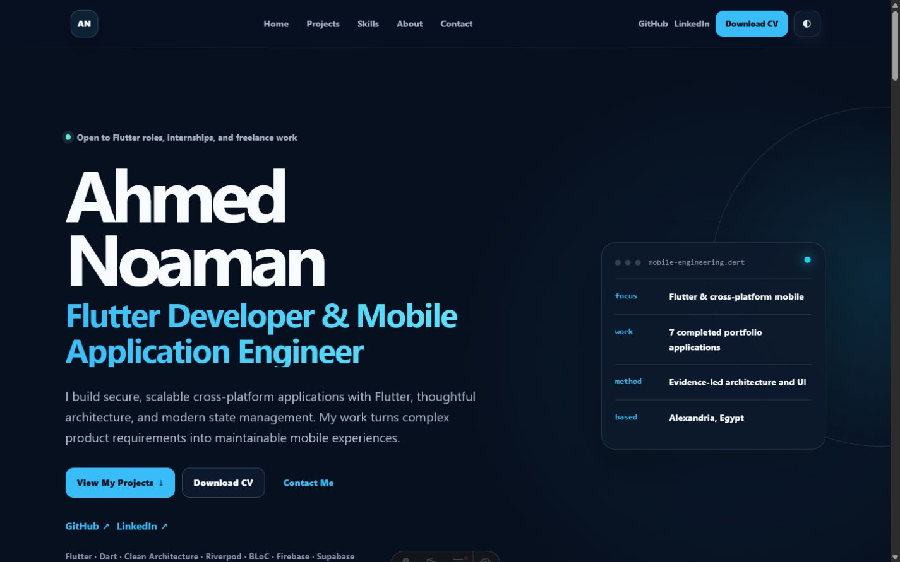

# Ahmed Noaman — Flutter Developer Portfolio

A fast, accessible static portfolio for Ahmed Mohamed Noaman, a Flutter Developer and Mobile Application Engineer based in Cairo, Egypt.

[View the live portfolio](https://noaman03.github.io) · [Download the CV](public/documents/Ahmed-Mohamed-Noaman-CV.pdf)



## What is included

- Eight evidence-led project profiles: one published freelance product (Strong 8K, client-owned private source, store listing and reviewed screenshots) and seven portfolio applications based on public repositories and supplied media.
- Three fixed featured projects, with the remaining five available through an accessible in-page disclosure.
- Responsive screenshot galleries, selectively loaded demo videos, project detail pages, and privacy-safe media.
- Dark and light themes, mobile navigation, structured data, social metadata, a sitemap, and a web app manifest.
- A revised public CV generated from `cv/cv_data.json`; it builds on Windows with Segoe UI and anywhere else with the bundled Selawik fonts (`cv/fonts/`, SIL OFL).

## Technology

- Astro 7 and TypeScript
- Tailwind CSS 4
- Static-site generation with minimal browser JavaScript
- Native HTML dialogs and video controls
- GitHub Actions and GitHub Pages
- Python/Pillow media preparation scripts

The project descriptions are a committed static snapshot. The deployed site does not query GitHub at runtime.

## Local development

Requirements: Node.js 24 and npm.

```bash
npm install
npm run dev
```

Astro serves the site at `http://localhost:4321` by default.

Run the complete verification pipeline:

```bash
npm test
```

Or run an individual command:

```bash
npm run check
npm run lint
npm run build
npm run validate
npm run format:check
```

Preview the production output locally with `npm run preview` after a successful build.

## Editing content

- Update personal details and expertise in `src/data/profile.ts`.
- Update project copy, repository links, labels, media, and ordering in `src/data/projects.ts`.
- Edit page composition in `src/pages/index.astro` and `src/pages/projects/[slug].astro`.
- Adjust the visual system and responsive rules in `src/styles/global.css`.

Project information should remain factual and traceable to a public repository, the supplied CV, or reviewed application media. Keep the first three `featured` entries fixed when editing the data snapshot.

## Project assets

Public media lives under `public/assets/projects/<project-slug>/`. Each project has a 16:9 WebP/AVIF thumbnail and a curated set of optimized gallery images. Only short, privacy-safe MP4 demos are committed.

Source media is intentionally excluded from Git. To regenerate selected assets, review the manifest and privacy decisions in `scripts/process_media.py`, then run:

```bash
python scripts/process_media.py
```

Do not add screenshots containing credentials, personal conversations, account data, private identifiers, or system overlays. Android application packages belong in each application's GitHub Releases, not in this website repository.

## Deployment

`.github/workflows/deploy.yml` checks, lints, builds, validates, uploads, and deploys the static `dist/` artifact. A push to `main` starts the workflow. In the repository's Pages settings, the source must be set to **GitHub Actions**.

Astro is configured for the root GitHub Pages site at `https://noaman03.github.io`, so asset URLs require no repository subpath.

## Repository structure

```text
.github/workflows/      GitHub Pages deployment
cv/                     Editable CV source and factual data
docs/                   Repository documentation and preview
public/                 Static assets, public CV, SEO files, icons
scripts/                Media, CV, and build-validation utilities
src/components/         Reusable Astro components
src/data/               Profile and project content snapshot
src/layouts/            Shared document layout and metadata
src/pages/              Home, project detail, and 404 pages
src/styles/             Global theme and responsive styles
output/pdf/             Delivered revised CV
```

## Accessibility

The site uses semantic landmarks, a skip link, visible focus styles, labelled controls, keyboard-operable navigation, reduced-motion handling, and native modal dialogs. Galleries support arrow-key navigation and Escape; closing a dialog returns focus to its trigger. The project disclosure maintains `aria-expanded` and `aria-controls` state.

## Performance and privacy

The site ships no client framework and makes no runtime content API requests. Responsive AVIF/WebP images include explicit dimensions, below-the-fold media is lazy loaded, and video sources are attached only when a user opens a demo. System fonts avoid render-blocking font requests.

Media was curated conservatively. Questionable screenshots and large application packages are excluded, original supplied files remain unchanged, and no phone number is published.

## CV updates

The downloadable file is `Ahmed-Mohamed-Noaman-CV.pdf`. Its editable HTML source is in `cv/`, and the delivered PDF is in `output/pdf/`. Keep the public filename stable so navigation and contact links continue to work after future revisions.
